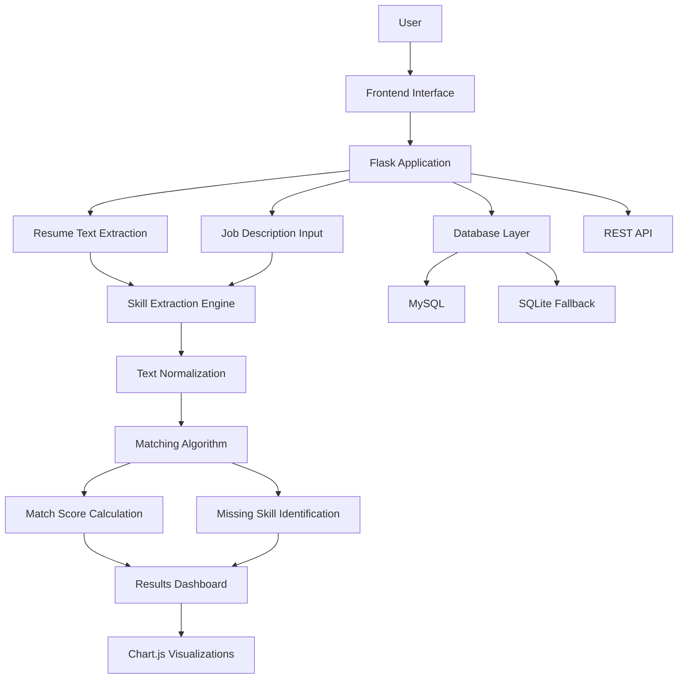

# ⚡ AI Resume & Job Description Matcher

A Python Flask-based web application that helps job seekers evaluate how well their resumes match specific job descriptions.

The application extracts text from PDF, DOCX, and TXT resumes, identifies relevant technical skills, calculates a matching percentage, and highlights missing skills based on job requirements.

It also provides an interactive dashboard where users can review analysis results, track previous scans, and understand which skills they may need to improve.

## 🖥️ Application Preview

<!-- Add the actual application screenshots here after the modification of ui -->

### Home Page


### Resume Analysis Results


### Analytics Dashboard


---

## 🛠️ Tech Stack

| Category | Technologies |
|---|---|
| Backend | Python, Flask, Werkzeug |
| Document Processing | PyPDF2, python-docx, Regular Expressions |
| Database | MySQL, SQLite |
| Frontend | HTML5, CSS3, JavaScript (ES6+) |
| UI Framework | Bootstrap 5 |
| Data Visualization | Chart.js, SVG |
| Icons & Fonts | Font Awesome, Plus Jakarta Sans, JetBrains Mono |
| Testing | Pytest, Python unittest |
| Version Control | Git, GitHub |

---

## 🚀 Key Features

- **Resume Upload and Text Extraction:** Supports PDF, DOCX, and TXT files, along with direct text input.
- **300+ Technical Skills Database:** Uses a predefined collection of skills organized into different technical categories.
- **Automated Skill Extraction:** Identifies relevant skills from resume content and job descriptions using keyword-based NLP techniques.
- **Resume Matching:** Compares extracted resume skills with job requirements and calculates a matching percentage.
- **Skill Gap Analysis:** Highlights missing technical skills and organizes them by category.
- **Interactive Results Dashboard:** Displays matching scores, matched skills, missing skills, and analysis insights.
- **Analytics Dashboard:** Maintains previous scan records and displays historical matching performance.
- **Data Visualization:** Uses Chart.js and custom SVG elements to present matching results visually.
- **MySQL and SQLite Support:** Supports MySQL as the primary database with SQLite as a fallback when configured in the application.
- **REST API:** Provides endpoints for resume analysis and accessing previous analysis records.
- **Sample Data:** Includes sample resume and job description content for testing the application.

---

## 🧠 Matching Algorithm

The application uses a rule-based keyword matching approach to evaluate the compatibility between a resume and a job description.

Instead of relying on a pre-trained machine learning model, it uses a predefined skill database to identify and compare relevant technical skills.

### Processing Workflow

1. **Resume Text Extraction:** Extracts textual content from uploaded PDF, DOCX, or TXT files.
2. **Text Normalization:** Processes the extracted content to make skill identification more consistent.
3. **Resume Skill Extraction:** Identifies technical skills using the predefined skill database.
4. **Job Description Analysis:** Extracts the required skills from the provided job description.
5. **Skill Comparison:** Compares resume skills with the required job skills using set operations.
6. **Match Calculation:** Calculates the percentage of required skills found in the resume.
7. **Skill Gap Identification:** Identifies missing skills and generates relevant recommendations.

### Matching Formula

The application calculates the percentage of required skills found in the resume.

**Match Percentage =**

`(Matched Skills / Total Required Skills) × 100`

Where:

- Matched Skills: Skills present in both the resume and job description.
- Total Required Skills: Total unique skills identified in the job description.

### Skill Gap Analysis

Missing skills are identified using set difference.

`Missing Skills = Required Skills - Resume Skills`

### Example

Consider a Python Developer job requiring the following skills:

**Required Skills:**
- Python
- Flask
- MySQL
- Docker
- Kubernetes

**Resume Skills:**
- Python
- Flask
- MySQL
- Docker

**Matching Skills:** 4

**Missing Skills:** Kubernetes

**Match Percentage:** 80%

This approach provides a straightforward way to understand how closely a resume aligns with the technical requirements of a job.

---

## 🏗️ System Architecture

The application follows a simple client-server architecture. The frontend communicates with the Flask backend, which handles document processing, skill extraction, matching, and database operations.



---

## 🔄 Application Workflow

The application processes resume and job description data through the following stages:

**1. Input**

The user uploads a resume and enters the target job description.

**2. Document Processing**

The backend extracts readable text from the uploaded document using the appropriate document processing library.

**3. Skill Identification**

The extracted text is processed to identify technical skills using the predefined skill database.

**4. Matching and Comparison**

The extracted resume skills are compared with the skills identified in the job description.

**5. Result Generation**

The application calculates the matching percentage, identifies missing skills, and generates recommendations.

**6. Dashboard and Storage**

The results are displayed through the dashboard, and analysis history is maintained using the database layer.

---

## 📂 Project Structure

```text
AI-resume-job-matcher/
│
├── app.py
├── matcher.py
├── db.py
├── config.py
│
├── requirements.txt
├── schema.sql
├── .env.example
├── .gitignore
├── README.md
│
├── templates/
│   ├── base.html
│   ├── index.html
│   ├── results.html
│   └── dashboard.html
│
├── static/
│   ├── css/
│   │   └── style.css
│   │
│   └── js/
│       └── main.js
│
├── samples/
│   ├── sample_resume.txt
│   └── sample_job_description.txt
│
├── tests/
│   └── test_matcher.py
│
└── uploads/
```

---

## ⚙️ Installation and Setup

Follow these steps to run the project locally.

### 1. Clone the Repository

```bash
git clone https://github.com/Cdev3/AI-resume-job-matcher.git

cd AI-resume-job-matcher
```

### 2. Create a Virtual Environment

```bash
python -m venv venv
```

### 3. Activate the Virtual Environment

**Windows:**

```bash
venv\Scripts\activate
```

**Linux / macOS:**

```bash
source venv/bin/activate
```

### 4. Install Dependencies

```bash
pip install -r requirements.txt
```

### 5. Configure Environment Variables

Create a `.env` file using the provided `.env.example` file.

Update the database configuration according to your environment.

Example MySQL configuration:

```env
DB_HOST=localhost
DB_PORT=3306
DB_USER=root
DB_PASSWORD=your_password
DB_NAME=resume_matcher
```

### 6. Database Setup

If you are using MySQL, create the database and import the provided SQL schema.

```bash
mysql -u root -p < schema.sql
```

If MySQL is unavailable, the application can use its configured SQLite fallback.

### 7. Run the Application

```bash
python app.py
```

Open the following URL in your browser:

```text
http://127.0.0.1:5000
```

### Quick Testing

Use the sample resume and job description provided in the `samples/` directory to test the matching functionality.

---

## 📡 REST API Documentation

The application provides REST API endpoints for programmatic resume analysis and accessing previous analysis records.

### 1. Analyze Resume

| Property | Value |
|---|---|
| Endpoint | `/api/analyze` |
| Method | POST |
| Content-Type | application/json |
| Purpose | Analyze resume against a job description |

**Sample Request:**

```json
{
    "candidate_name": "David Miller",
    "job_title": "Python Developer",
    "resume_text": "Experienced in Python, Flask, MySQL, Docker, and Git.",
    "job_description": "Seeking a Python Developer with Flask, MySQL, Docker, and Kubernetes."
}
```

**Sample Response:**

```json
{
    "match_score": 80.0,
    "matched_skills": [
        "docker",
        "flask",
        "mysql",
        "python"
    ],
    "missing_skills": [
        "kubernetes"
    ],
    "total_jd_skills": 5,
    "total_matched": 4,
    "total_missing": 1,
    "recommendations": [
        {
            "icon": "fa-award",
            "message": "Your profile is strongly aligned with this role.",
            "title": "Strong Match",
            "type": "success"
        }
    ]
}
```

*Note: The request and response above illustrate the intended API format. Refer to the actual Flask route implementation for the exact fields and response structure.*

### 2. Analysis History

| Property | Value |
|---|---|
| Endpoint | `/api/history` |
| Method | GET |
| Purpose | Retrieve previous resume analysis records |

The application also supports history management through the dashboard.

---

## 🧪 Running Tests

The project includes unit tests for validating the resume and job description matching logic.

Run the test suite using:

```bash
pytest tests/ -v
```

---

## 🔮 Future Enhancements

Some improvements planned for future versions include:

- Semantic similarity using Sentence Transformers.
- LLM-based resume improvement suggestions.
- ATS-friendly resume structure evaluation.
- Job-specific interview question generation.
- Personalized learning recommendations based on missing skills.
- Integration with external job listing APIs.
- User authentication and personalized dashboards.

---

## 👨‍💻 Author

**Charan Dev**

B.Tech Computer Science and Engineering

- GitHub: [Cdev3](https://github.com/Cdev3)
- Project Repository: [AI Resume & Job Description Matcher](https://github.com/Cdev3/AI-resume-job-matcher)

---

**Built with Python, Flask, and a focus on helping job seekers understand their technical skill gaps.**
