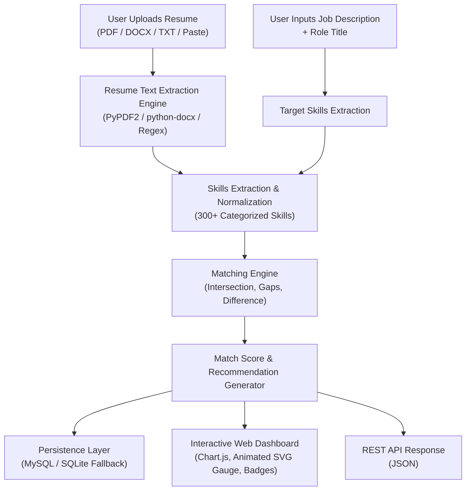

<div align="center">

# ⚡ AI Resume & Job Description Matcher

An intelligent, full-stack application that extracts textual content from resumes (PDF, DOCX, TXT), evaluates them against job descriptions via keyword-based NLP matching, computes match percentages, highlights critical skill gaps, and delivers actionable career recommendations through an interactive dashboard.

[](https://www.python.org/)
[](https://flask.palletsprojects.com/)
[](https://www.mysql.com/)
[](https://developer.mozilla.org/)
[](https://developer.mozilla.org/)
[](https://developer.mozilla.org/)
[](https://getbootstrap.com/)
[](LICENSE)

</div>

---

## 📌 Resume Bullet Points (Copy & Paste to Resume)

If you are showcasing this project on your software engineering resume, here are pre-crafted, high-impact bullet points:

- **AI Resume & Job Description Matcher** | *Python, Flask, MySQL, HTML, CSS, JavaScript*
  - Developed a full-stack web application to parse resumes (PDF, DOCX, TXT) and benchmark qualifications against job descriptions using automated NLP keyword extraction.
  - Built an intelligent skill gap analysis engine mapping 300+ skills across 10 technical categories, computing match percentages and delivering strategic upskilling recommendations.
  - Designed an interactive analytics dashboard featuring Chart.js visual breakdowns, score trends, and MySQL persistence with automated zero-configuration database fallback.
  - Engineered RESTful API endpoints for headless document evaluation and integrated responsive glassmorphic UI using Bootstrap 5 and vanilla JavaScript.

---

## 🚀 Key Features

- **Multi-Format Resume Text Extraction:** Accepts **PDF, DOCX, and TXT** documents as well as direct text inputs with secure in-memory processing.
- **300+ Industry Skill Database:** Granular taxonomy covering:
  - *Programming Languages* (Python, Java, Go, Rust, TypeScript, C++, etc.)
  - *Frontend & Web* (React, Vue, Next.js, HTML5, CSS3, Tailwind, etc.)
  - *Backend & Frameworks* (Flask, Django, FastAPI, Spring Boot, Express, Node.js, etc.)
  - *Databases & Storage* (MySQL, PostgreSQL, MongoDB, Redis, etc.)
  - *Cloud & DevOps* (AWS, GCP, Azure, Docker, Kubernetes, CI/CD, Terraform, etc.)
  - *AI, Machine Learning & Data Science* (PyTorch, TensorFlow, LLMs, Pandas, NLP, etc.)
  - *Engineering Methodologies & Testing* (Pytest, Git, Agile, Scrum, Docker, etc.)
  - *Soft Skills & Leadership*
- **Precision Matching Algorithm:** Evaluates intersection, union, and difference between resume and job criteria to provide accurate, transparent score metrics.
- **Missing Skill Gap Identification:** Clearly flags missing prerequisites categorized by technical domain so candidates can tailor their applications.
- **Dynamic Visual Analytics:** Real-time Chart.js bar charts and score gauge with animated SVG transitions.
- **Interactive Analytics Dashboard:** Tracks past scans, top scores, average fit rates, and historical performance with search and delete functions.
- **MySQL & Zero-Config SQLite Fallback:** Automatically connects to MySQL if present, with transparent local SQLite failover for immediate frictionless demonstration.
- **RESTful API:** Headless `/api/analyze` and `/api/history` endpoints for programmatic third-party integrations.

---

## 🏗️ System Architecture



---

## 📂 Project Structure

```
resume_matcher/
├── app.py                      # Flask Application Server & Routes
├── matcher.py                  # Core NLP, Skill Extraction & Match Pipeline
├── db.py                       # Database Layer (MySQL + SQLite Fallback)
├── config.py                   # Configuration & Environment Variables
├── requirements.txt            # Python Dependencies
├── schema.sql                  # MySQL Database DDL & Seed Data
├── .env.example                # Sample Environment Variables
├── .gitignore                  # Git Ignore Configuration
├── README.md                   # Complete Documentation
├── LICENSE                     # MIT License
├── templates/
│   ├── base.html               # Common Layout, Navbar & Footer
│   ├── index.html              # Main Landing, File Upload & Text Form
│   ├── results.html            # Scan Results, Match Gauge & Gap Breakdown
│   └── dashboard.html          # Historical Analytics & Score Distribution
├── static/
│   ├── css/
│   │   └── style.css           # Glassmorphism, Dark UI & Custom Components
│   └── js/
│       └── main.js             # Client Interactivity & Validation
├── samples/
│   ├── sample_resume.txt       # Ready-to-test Demo Resume
│   └── sample_job_description.txt # Ready-to-test Demo Job Description
├── tests/
│   └── test_matcher.py         # Pytest Unit Tests for Matching Logic
└── uploads/                    # Temporary Storage for File Processing
```

---

## 💻 Tech Stack Breakdown

| Tier | Technologies |
| :--- | :--- |
| **Backend** | Python 3.9+, Flask 3.0, Werkzeug |
| **Document Processing** | PyPDF2, python-docx, Regular Expressions |
| **Database** | MySQL 8.0, mysql-connector-python, SQLite3 |
| **Frontend UI** | HTML5, CSS3, JavaScript (ES6+), Bootstrap 5.3 |
| **Data Visualization** | Chart.js 4.4, Custom SVG Animated Radial Gauge |
| **Icons & Fonts** | Font Awesome 6.5, Plus Jakarta Sans, JetBrains Mono |
| **Testing** | Pytest, Python unittest |

---

## ⚙️ Installation & Quickstart

### 1. Clone the Repository
```bash
git clone https://github.com/your-username/resume-matcher.git
cd resume-matcher
```

### 2. Create and Activate Virtual Environment
```bash
# Windows
python -m venv venv
venv\Scripts\activate

# macOS / Linux
python3 -m venv venv
source venv/bin/activate
```

### 3. Install Required Dependencies
```bash
pip install -r requirements.txt
```

### 4. Database Setup (Optional)
The application includes an **automatic fallback** to SQLite if MySQL is not running on your machine. To connect to your MySQL server:

1. Import schema:
```bash
mysql -u root -p < schema.sql
```
2. Copy `.env.example` to `.env` and fill in credentials:
```env
DB_HOST=localhost
DB_PORT=3306
DB_USER=root
DB_PASSWORD=your_password
DB_NAME=resume_matcher
```

### 5. Launch Application
```bash
python app.py
```
Visit `http://127.0.0.1:5000` in your browser.

> 💡 **Quick Test Tip:** On the home page, simply click the **"Load Sample Data"** button to instantly populate both the resume and job description fields with high quality sample data, then hit **"Analyze Match & Skill Gaps"**!

---

## 🧪 Running Unit Tests

Run the test suite using `pytest`:

```bash
pytest tests/ -v
```

---

## 📡 REST API Documentation

### Analyze Resume & Job Description
- **Endpoint:** `POST /api/analyze`
- **Content-Type:** `application/json`

**Sample Request:**
```json
{
  "candidate_name": "David Miller",
  "job_title": "Full Stack Python Engineer",
  "resume_text": "Experienced in Python, Flask, MySQL, Docker, and Git.",
  "job_description": "Seeking Python Developer with Flask, MySQL, Docker, Kubernetes, and AWS."
}
```

**Sample Response:**
```json
{
  "match_score": 80.0,
  "matched_skills": ["docker", "flask", "mysql", "python"],
  "missing_skills": ["aws", "kubernetes"],
  "total_jd_skills": 5,
  "total_matched": 4,
  "total_missing": 1,
  "recommendations": [
    {
      "icon": "fa-award",
      "message": "Your profile is strongly aligned with this role...",
      "title": "Outstanding Match!",
      "type": "success"
    }
  ]
}
```

---

## 📜 License

This project is licensed under the MIT License - see the [LICENSE](LICENSE) file for details.
