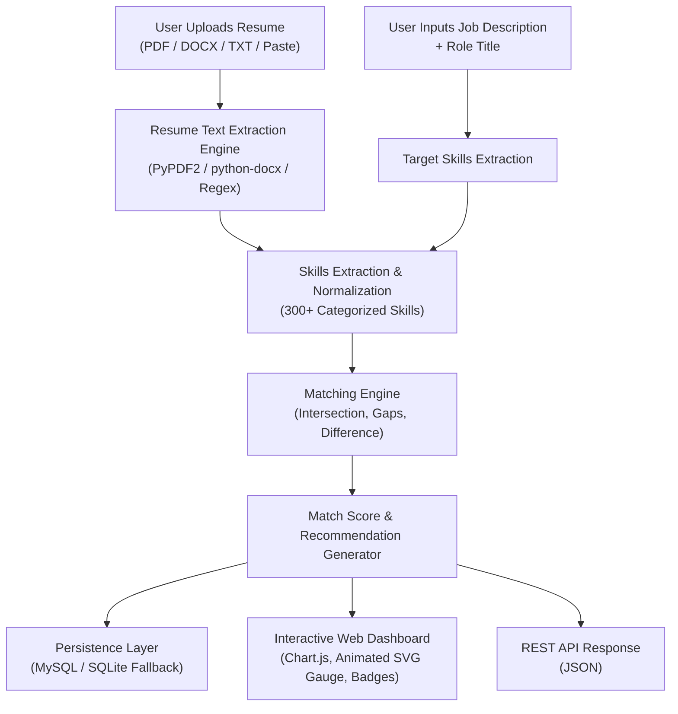

<div align="center">

# ⚡ AI Resume & Job Description Matcher

An intelligent Python Flask-based web application that analyzes resumes against job descriptions to identify skill compatibility, calculate matching scores, and highlight missing technical skills.

The application extracts text from PDF, DOCX, and TXT resumes, applies rule-based NLP techniques for skill identification, and generates actionable skill-gap insights through an interactive analytics dashboard.

Built to help job seekers understand how closely their qualifications align with specific job requirements.

---

## 🧠 Matching Algorithm

The application uses rule-based keyword matching
to compare extracted resume skills with job
description requirements.

### Processing Steps

1. Extract text from the uploaded resume.
2. Normalize the extracted text.
3. Identify technical skills using a predefined
   skill database.
4. Extract required skills from the job description.
5. Compare the two skill sets.
6. Calculate the matching percentage.
7. Identify missing skills.

### Matching Formula

Match Percentage =

(Common Skills / Total Required Skills) * 100

### Skill Gap Analysis

Missing Skills =

Required Skills - Resume Skills


---

## 🚀 Key Features

- **Multi-Format Resume Text Extraction:** Accepts **PDF, DOCX, and TXT** documents as well as direct text inputs with secure in-memory processing.
- **300+ Industry Skill Database:** Granular taxonomy covering:
  - *Programming Languages* (Python, Java, Go, Rust, TypeScript, C++, etc.)
  - *Frontend & Web* (React, Vue, Next.js, HTML5, CSS3, Tailwind, etc.)
  - *Backend & Frameworks* (Flask, Django, FastAPI, Spring Boot, Express, Node.js, etc.)
  - *Databases & Storage* (MySQL, PostgreSQL, MongoDB, Redis, etc.)
  - *Cloud & DevOps* (AWS, GCP, Azure, Docker, Kubernetes, CI/CD, Terraform, etc.)
  - *AI, Machine Learning & Data Science* (PyTorch, TensorFlow, LLMs, Pandas, NLP, etc.)
  - *Engineering Methodologies & Testing* (Pytest, Git, Agile, Scrum, Docker, etc.)
  - *Soft Skills & Leadership*
- **Precision Matching Algorithm:** Evaluates intersection, union, and difference between resume and job criteria to provide accurate, transparent score metrics.
- **Missing Skill Gap Identification:** Clearly flags missing prerequisites categorized by technical domain so candidates can tailor their applications.
- **Dynamic Visual Analytics:** Real-time Chart.js bar charts and score gauge with animated SVG transitions.
- **Interactive Analytics Dashboard:** Tracks past scans, top scores, average fit rates, and historical performance with search and delete functions.
- **MySQL & Zero-Config SQLite Fallback:** Automatically connects to MySQL if present, with transparent local SQLite failover for immediate frictionless demonstration.
- **RESTful API:** Headless `/api/analyze` and `/api/history` endpoints for programmatic third-party integrations.

---

## 🏗️ System Architecture



---

## 📂 Project Structure

```
AI-resume-job-matcher/
│
├── README.md
├── LICENSE
├── requirements.txt
├── .env.example
├── .gitignore
│
├── app.py
├── config.py
│
├── backend/
│   ├── __init__.py
│   ├── matcher.py
│   ├── db.py
│   └── ...
│
├── templates/
│   ├── base.html
│   ├── index.html
│   ├── results.html
│   └── dashboard.html
│
├── static/
│   ├── css/
│   ├── js/
│   └── images/
│
├── database/
│   └── schema.sql
│
├── samples/
│   ├── sample_resume.txt
│   └── sample_job_description.txt
│
├── tests/
│   └── test_matcher.py
│
└── screenshots/
    ├── home.png
    ├── results.png
    └── dashboard.png
---

## 💻 Tech Stack Breakdown

| Tier | Technologies |
| :--- | :--- |
| **Backend** | Python 3.9+, Flask 3.0, Werkzeug |
| **Document Processing** | PyPDF2, python-docx, Regular Expressions |
| **Database** | MySQL 8.0, mysql-connector-python, SQLite3 |
| **Frontend UI** | HTML5, CSS3, JavaScript (ES6+), Bootstrap 5.3 |
| **Data Visualization** | Chart.js 4.4, Custom SVG Animated Radial Gauge |
| **Icons & Fonts** | Font Awesome 6.5, Plus Jakarta Sans, JetBrains Mono |
| **Testing** | Pytest, Python unittest |

---

## ⚙️ Installation & Quickstart

### 1. Clone the Repository
```bash
git clone https://github.com/your-username/resume-matcher.git
cd resume-matcher
```

### 2. Create and Activate Virtual Environment
```bash
# Windows
python -m venv venv
venv\Scripts\activate

# macOS / Linux
python3 -m venv venv
source venv/bin/activate
```

### 3. Install Required Dependencies
```bash
pip install -r requirements.txt
```

### 4. Database Setup (Optional)
The application includes an **automatic fallback** to SQLite if MySQL is not running on your machine. To connect to your MySQL server:

1. Import schema:
```bash
mysql -u root -p < schema.sql
```
2. Copy `.env.example` to `.env` and fill in credentials:
```env
DB_HOST=localhost
DB_PORT=3306
DB_USER=root
DB_PASSWORD=your_password
DB_NAME=resume_matcher
```

### 5. Launch Application
```bash
python app.py
```
Visit `http://127.0.0.1:5000` in your browser.

> 💡 **Quick Test Tip:** On the home page, simply click the **"Load Sample Data"** button to instantly populate both the resume and job description fields with high quality sample data, then hit **"Analyze Match & Skill Gaps"**!

---

## 🧪 Running Unit Tests

Run the test suite using `pytest`:

```bash
pytest tests/ -v
```

---

## 📡 REST API Documentation

### Analyze Resume & Job Description
- **Endpoint:** `POST /api/analyze`
- **Content-Type:** `application/json`

**Sample Request:**
```json
{
  "candidate_name": "David Miller",
  "job_title": "Full Stack Python Engineer",
  "resume_text": "Experienced in Python, Flask, MySQL, Docker, and Git.",
  "job_description": "Seeking Python Developer with Flask, MySQL, Docker, Kubernetes, and AWS."
}
```

**Sample Response:**
```json
{
  "match_score": 80.0,
  "matched_skills": ["docker", "flask", "mysql", "python"],
  "missing_skills": ["aws", "kubernetes"],
  "total_jd_skills": 5,
  "total_matched": 4,
  "total_missing": 1,
  "recommendations": [
    {
      "icon": "fa-award",
      "message": "Your profile is strongly aligned with this role...",
      "title": "Outstanding Match!",
      "type": "success"
    }
  ]
}
```

---

## 📜 License

This project is licensed under the MIT License - see the [LICENSE](LICENSE) file for details.
 
